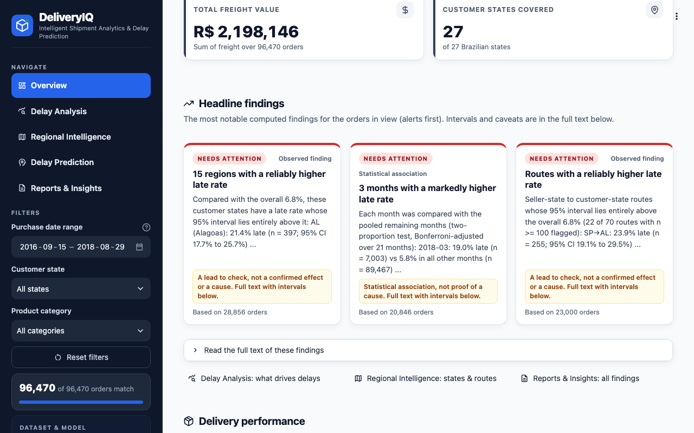
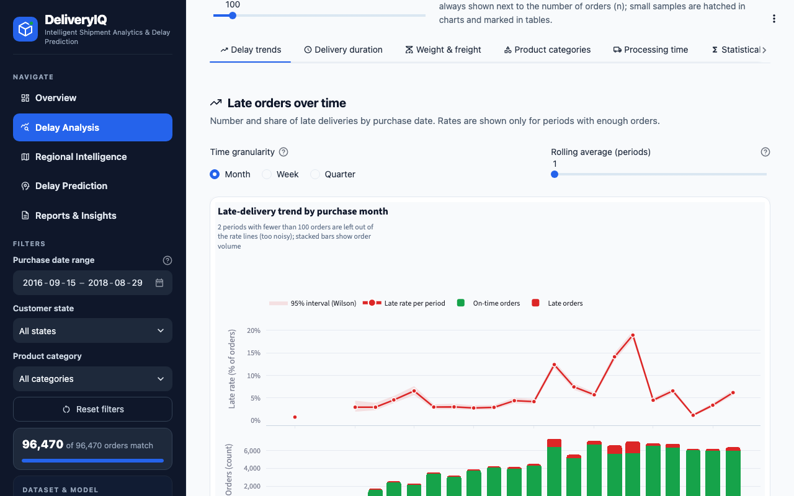
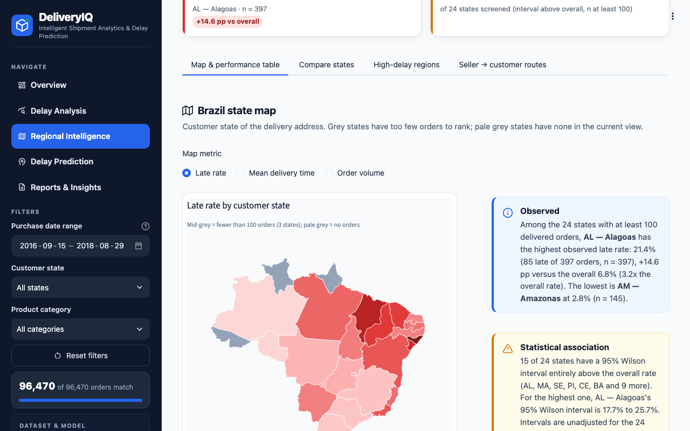
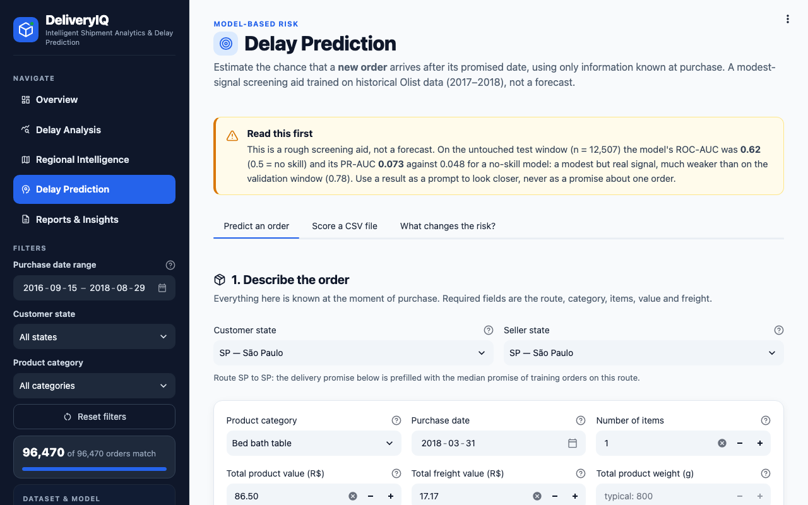
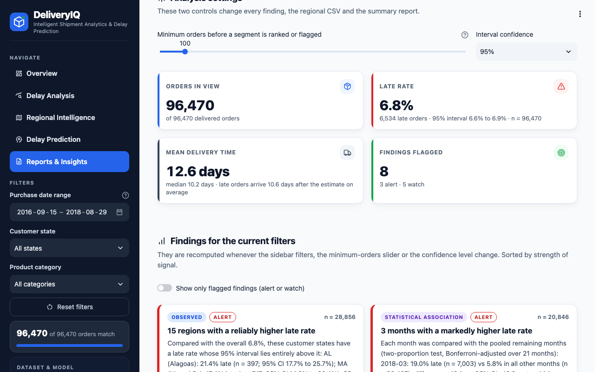

# DeliveryIQ

DeliveryIQ is a Streamlit app that analyses **late deliveries in the Olist Brazilian e-commerce dataset** (about 99,000 orders
placed between 2016 and 2018) and includes a **delay classifier** that scores a new order's risk of arriving after its promised
date. It is a descriptive analytics project, not a causal study: every finding is an association in historical data, and the
prediction model has a modest signal on later data (see [Known limitations](#known-limitations-and-what-was-not-done)).

"Late" means the customer received the order on a calendar date after the estimated delivery date shown at checkout.



## The five pages

| Page | URL path | What it shows |
|---|---|---|
| **Overview** | `/` | Headline KPIs (orders, late rate with its 95% interval, delivery time), on-time vs late split, delivery-time distribution, monthly late rate with order volume, a regional late-rate ranking and a short list of computed headline findings. |
| **Delay Analysis** | `/delay-analysis` | Six tabs: delay trends over time, delivery-duration distribution, weight and freight vs delivery time, product categories, seller processing time (retrospective), and statistical tests (chi-square, Spearman, Kruskal-Wallis, with effect sizes and plain-language readings). |
| **Regional Intelligence** | `/regional-intelligence` | Four tabs: a Brazil map plus state table (CSV export), state-vs-state comparison, a screen for high-delay regions, and seller-state to customer-state routes (same-state vs cross-state). |
| **Delay Prediction** | `/delay-prediction` | Three tabs: score one hypothetical order from purchase-time inputs (with risk band, assumptions used and warnings), score a CSV file of orders, and a "what changes the risk?" sensitivity view. |
| **Reports & Insights** | `/reports-insights` | Four tabs: key findings with an adjustable confidence level, downloads (shipment CSV, regional CSV, summary report as .md/.html, charts as .html), a filterable data explorer, and the model evaluation (validation vs test metrics, risk bands, importances). |

The sidebar filters (purchase date range, customer state, product category) drive the analysis pages and the findings,
downloads and explorer on Reports & Insights; the model evaluation is a fixed historical test and does not change with them. Rates are always shown with their order counts and, where it matters, a 95% Wilson interval.

| Delay Analysis | Regional Intelligence |
|---|---|
|  |  |
| **Delay Prediction** | **Reports & Insights** |
|  |  |

(Screenshots are 1280x800 captures of the running app, taken from the real data.)

## What a fresh clone contains and what it needs

Checked against `.gitignore` and `git ls-files`:

| Item | In git? | Notes |
|---|---|---|
| Source code (`app.py`, `src/`, `views/`, `tests/`, `notebooks/`, `docs/`, `reports/figures/`) | yes | |
| `models/delay_classifier.joblib`, `models/model_metrics.json` | **yes** | The trained model is committed, so you do **not** have to train to run the app. |
| `data/geo/brazil_states.geojson` | yes | Simplified state outlines for the map. |
| `data/processed/data_quality_report.json` | yes | Written by preprocessing. |
| `data/raw/*.csv` (the Olist CSVs) | **no** (git-ignored) | **You must download these** (step 3). |
| `data/processed/orders_all.parquet`, `orders_delivered.parquet`, `orders_delivered.csv` | **no** (git-ignored, regenerated) | **You must generate these** (step 4). Until you do, the app shows a "Set up your data" page. |
| `.venv/` | no | You create it (step 1). |

## Setup and run (from a fresh clone)

Requires **Python 3.12** (the version the project was built and tested with) and roughly 1 GB of disk (about 0.9 GB for the virtual
environment, 120 MB for the raw and processed data). Commands are for macOS/Linux; on Windows use `.venv\Scripts\python` instead of
`.venv/bin/python`. The app's own error messages quote `.venv/bin/python`, so this guide uses that path rather than
activating the environment.

**1. Clone and create the environment**

```bash
git clone https://github.com/keertika0704/delivery_systerm.git deliveryiq
cd deliveryiq
python3.12 -m venv .venv
.venv/bin/pip install -r requirements.txt
```

`requirements.txt` pins `pandas>=3.0,<4`, `numpy>=2,<3`, `streamlit>=1.50`, `scikit-learn>=1.6` and friends. The committed model
was trained with scikit-learn 1.9.1 (the version `pip` resolved in a clean environment when this guide was checked); with a
different version the app still loads it but warns, and you should retrain (step 5).

**2. (Optional, tests only) browser tests** need Playwright, which is deliberately not in `requirements.txt`:

```bash
.venv/bin/pip install playwright
.venv/bin/python -m playwright install chromium
```

**3. Download the Olist data and place it in `data/raw/`**

Download "Brazilian E-Commerce Public Dataset by Olist" from <https://www.kaggle.com/datasets/olistbr/brazilian-ecommerce>
(free Kaggle account; check the licence on that page). Unzip it and copy these files into `data/raw/`:

* required: `olist_orders_dataset.csv`, `olist_order_items_dataset.csv`, `olist_customers_dataset.csv`,
  `olist_sellers_dataset.csv`, `olist_products_dataset.csv`
* optional but recommended: `olist_order_reviews_dataset.csv`, `product_category_name_translation.csv`
  (without the translation file, category names stay in Portuguese)

The geolocation file in the archive is not used. For example, from the downloaded zip:

```bash
mkdir -p data/raw
unzip -j ~/Downloads/brazilian-ecommerce.zip \
  olist_orders_dataset.csv olist_order_items_dataset.csv olist_customers_dataset.csv \
  olist_sellers_dataset.csv olist_products_dataset.csv olist_order_reviews_dataset.csv \
  product_category_name_translation.csv -d data/raw
```

(Or, with the Kaggle CLI configured: `kaggle datasets download -d olistbr/brazilian-ecommerce -p ~/Downloads`.)

**4. Build the processed tables** (about 5 to 10 seconds)

```bash
.venv/bin/python -m src.preprocessing
```

This reads the raw CSVs, cleans and joins them to one row per order, defines the late label, and writes
`data/processed/orders_all.parquet`, `orders_delivered.parquet`, `orders_delivered.csv` and `data_quality_report.json`, then
prints a cleaning log. Note that it rewrites the tracked `data_quality_report.json` (only the timestamp and absolute paths
inside it change), so git will show it as modified.

**5. (Optional) Retrain the model** (about 2 minutes)

```bash
.venv/bin/python -m src.train_model
```

This is only needed if you changed the data or features, or run a different scikit-learn version. It trains a dummy baseline,
logistic regression, random forest and histogram gradient boosting on a chronological split, then **overwrites the tracked
files** `models/delay_classifier.joblib` and `models/model_metrics.json` (and prints a summary). The command has no flags; to
write somewhere else call `train_model.train(out_dir=...)` from Python.

**6. Run the app**

```bash
.venv/bin/python -m streamlit run app.py
```

Open <http://localhost:8501>. The first page load after starting the server takes a few seconds (it shows a "Loading the
analysis tools" notice while pandas, scipy, scikit-learn and plotly import).

**7. Run the tests**

```bash
.venv/bin/python -m pytest -q
```

With the processed data, the committed model, and Playwright + Chromium installed, the full suite was last run as
**966 passed in about 5 minutes** (the browser smoke tests in `tests/test_browser_smoke.py` start their own server and need
step 2; without Playwright or Chromium they are skipped, and tests that need the processed data or model skip with a message
naming the command that creates it).

**8. Regenerate the findings document**

```bash
.venv/bin/python scripts/generate_findings.py
```

Rewrites [`docs/FINDINGS.md`](docs/FINDINGS.md); every number in it is computed from the processed data, the quality report
and `models/model_metrics.json`.

### What the app says when something is missing

| Situation | What you see | Fix |
|---|---|---|
| `data/processed/orders_delivered.parquet` missing (fresh clone) | A **"Set up your data"** page on every URL with the card **"Processed data not found"**: steps to download the dataset from Kaggle, copy the CSVs into `data/raw/`, and build the tables, with the command `.venv/bin/python -m src.preprocessing` in a copyable block. A caption notes that training the model is optional. | Do steps 3 and 4 above, then reload. |
| Raw CSVs missing when you run preprocessing | The command prints `ERROR: Required Olist raw file(s) not found in .../data/raw:` followed by the missing file names, the Kaggle URL and placement instructions, and exits with status 1. | Place the files (step 3). |
| Processed file exists but cannot be read | Card **"The processed data could not be read"** with the underlying error and the preprocessing command. | Re-run step 4. |
| `models/delay_classifier.joblib` missing or unreadable | The Delay Prediction page shows **"The prediction model is not available"**: "Train it once (about two minutes) and reload this page. The other pages keep working without it.", the reason, and `.venv/bin/python -m src.train_model`. Other pages work; the Reports model-evaluation tab reads `models/model_metrics.json`, so it shows a notice only if that file is missing too. | Step 5, then reload the page (no server restart needed). |
| Model trained with another scikit-learn version | A warning `Model trained with scikit-learn X, running Y; retrain with: ...` | Step 5. |

## Project structure

```
app.py                      Entry point: page config, loading notice, st.navigation over views/, sidebar, data gate
views/                      The five Streamlit pages (run by st.navigation, not by Streamlit's pages/ discovery)
  1_Overview.py  2_Delay_Analysis.py  3_Regional_Intelligence.py  4_Delay_Prediction.py  5_Reports_Insights.py
src/
  config.py                 Paths, column groups (purchase-time vs leakage), palette, defaults
  preprocessing.py          Raw CSV -> processed parquet + quality report  (CLI: python -m src.preprocessing)
  feature_engineering.py    Order-level aggregation, targets, time and geography features, schema validation
  analytics.py              Filters, KPIs, segment tables, Wilson intervals (pure pandas, no Streamlit)
  statistical_analysis.py   Chi-square, Spearman, proportion tests, Holm adjustment, plain-language readings
  insights.py               Computed findings, recommendations and the summary report text
  train_model.py            Chronological split, model comparison, calibration, risk bands  (CLI: python -m src.train_model)
  prediction.py             Model loading, input validation, single and batch scoring
  prediction_helpers.py     Wording and tables for the prediction page
  charts.py                 Plotly figure builders with one shared template
  delay_narrative.py, overview_text.py   Text generated from computed numbers
  exports.py                CSV / Markdown / HTML report builders
  ui.py                     The only module that imports Streamlit: CSS, cached loaders, sidebar, filters, formatters
data/raw/                   Olist CSVs (git-ignored; you download them)
data/processed/             Generated tables (parquet/csv git-ignored); data_quality_report.json is tracked
data/geo/                   brazil_states.geojson + SOURCE.txt (provenance and licence note)
models/                     delay_classifier.joblib, model_metrics.json (tracked)
notebooks/                  01 data exploration, 02 statistical analysis, 03 model training (+ _build_nb*.py generators)
reports/figures/            PNGs written by the notebooks
scripts/generate_findings.py  Builds docs/FINDINGS.md from the data and model metrics
tests/                      pytest suite (see docs/ARCHITECTURE.md)
docs/                       ARCHITECTURE.md, FINDINGS.md, images/
```

### Why `views/` and not `pages/`

Streamlit automatically turns a folder named `pages/` into a multipage app. This project builds its own navigation with
`st.navigation`, and having both made direct page URLs show a "Page not found" dialog on the first visit after a server start.
The page files therefore live in `views/`, and `app.py` registers them explicitly with these URL paths: `/` (Overview),
`/delay-analysis`, `/regional-intelligence`, `/delay-prediction`, `/reports-insights`. The old `pages/` slugs (for example
`/Delay_Analysis`) **no longer resolve**. `tests/test_browser_smoke.py` guards the deep links in a real browser.

## Key results (details and caveats in [docs/FINDINGS.md](docs/FINDINGS.md))

* 96,470 delivered orders were analysed; 6.77% arrived after the estimated date. The late rate was far from constant: three
  months (2017-11, 2018-02, 2018-03) were markedly higher than the rest.
* Late rates differ by region and route (north-eastern states and some São Paulo-to-elsewhere routes are higher in the
  all-history data), but these segment screens are unadjusted multiple comparisons: flagged segments are leads, not confirmed effects,
  and the cross-state vs same-state pattern reversed in the most recent time window.
* The model is a **modest** screening aid. On the later test window its ROC-AUC is 0.617 (0.5 is chance) and its PR-AUC lift
  over the base rate is 1.5x (validation looked much better at 3.4x), and its probabilities are not better than quoting the base rate.

## Known limitations and what was not done

* **Review coverage.** Browser reviews of user flows A, B and C and a cross-page consistency check were **never run**. A review
  of flow D and a design review were run. The automated suite (unit tests, Streamlit `AppTest` page tests and the browser
  smoke test for deep links and the phone drawer) is not a substitute for those reviews.
* **Open design and wording findings.** About 16 minor design and wording findings from the design review remain
  unaddressed, including tablet-width layout, chart spacing, table truncation, and missing tooltips for statistical terms.
* **Notebooks.** Notebooks 02 and 03 had **no final re-audit** after the last round of code changes. Notebook 03 explains the
  training protocol, re-derives parts of it and cross-checks its quoted numbers against `models/model_metrics.json`; the model
  itself is produced by `python -m src.train_model`, not by the notebook.
* **URLs.** The old `pages/` URL slugs no longer resolve (see above). The default page is always served at `/`, so `/overview`
  is "Page not found".
* **Model limitations.**
  * Test-window (July-August 2018) performance is modest and clearly below validation: ROC-AUC 0.617 vs 0.781, PR-AUC lift 1.5x vs 3.4x
    (validation figures are tuned and optimistic). Brier score and log-loss are not better than a constant base-rate predictor.
  * The delay regime shifted over time (late rate 8.0% in training, 4.2% validation, 4.8% test), and the same-state/cross-state
    relationship the model learned reversed in the test window. Calendar month and year are deliberately not used.
  * Predicted probabilities are a step function of 30 distinct levels and overstate risk on the test window (mean predicted
    7.5% vs 4.8% observed); the Moderate and High bands overlap statistically on test. Read bands as a coarse ranking.
  * About 10% of test orders have a checkout promise outside the range seen in training (the model extrapolates).
  * Only delivered orders are labelled; orders still in transit when the data ends cannot be, so late months may be understated.
  * Purchase-time inputs only: carrier, weather, holiday and seller-capacity information is not in the data. Associations, not causes.
* **Data licence.** The Olist data is not redistributed in this repository; download it from Kaggle and check its licence. The
  state boundary file is a simplified derivative of a third-party dataset (see `data/geo/SOURCE.txt`).
